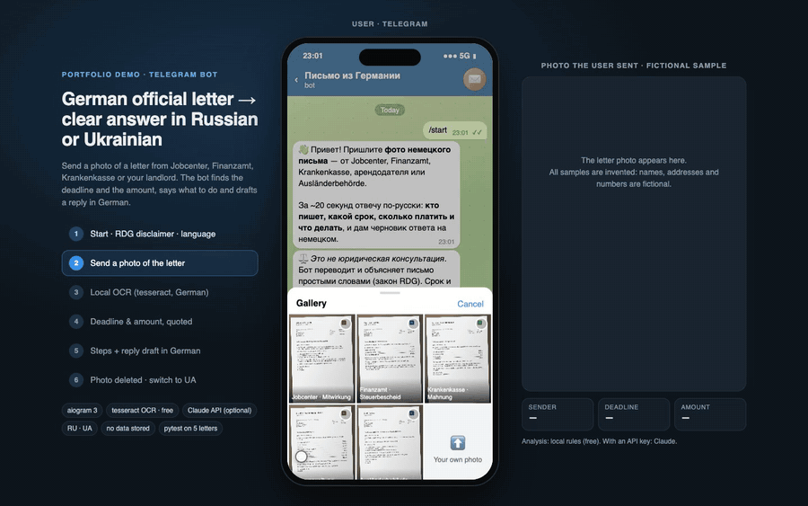
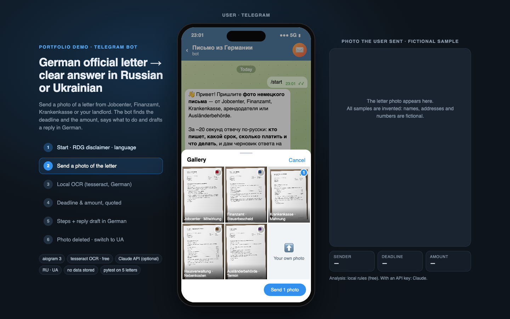
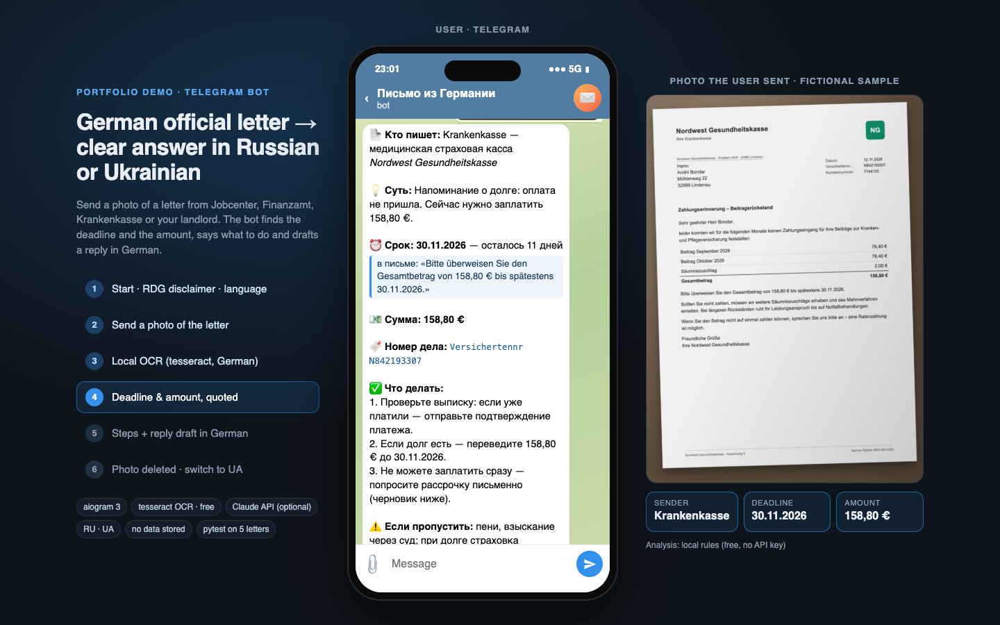
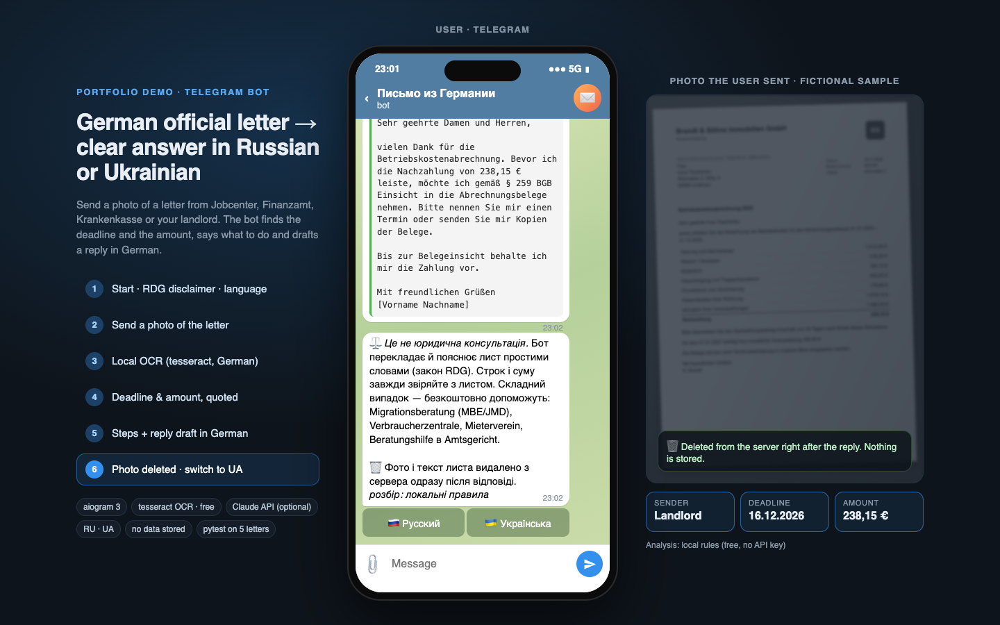

# Letter Bot: German official letters, explained in Russian or Ukrainian

A Telegram bot. The user sends a **photo of a German official letter** (Jobcenter, Finanzamt, Krankenkasse, landlord, Ausländerbehörde). Within seconds the bot answers in **Russian or Ukrainian**: who wrote it, the **deadline**, the **amount to pay**, what to do step by step, and a **reply draft in German**.



▶️ **Full demo video (50 s):**

https://github.com/user-attachments/assets/0b4e615d-e957-42d9-bcc1-c0c260325351

| Pick a letter | Answer in Russian | Answer in Ukrainian + reply draft |
|---|---|---|
|  |  |  |

> All 5 sample letters in `samples/` are **invented**: names, addresses, numbers and the town "Lindenau" are fictional.

*Русская версия ниже.*

## What it does
- **Photo → text, locally and for free:** tesseract OCR with the German model. Falls back to macOS Vision if tesseract is missing. No paid OCR API.
- **Finds the facts and quotes them:**
  - **Sender:** Jobcenter, Finanzamt, Krankenkasse, Vermieter/Hausverwaltung, Ausländerbehörde, Beitragsservice, Familienkasse.
  - **Letter type:** reminder (Mahnung), decision (Bescheid), utility bill (Nebenkostenabrechnung), request for documents (Mitwirkung), appointment (Termin).
  - **Deadline:** "bis zum …", "spätestens …", "Termin am …". Relative periods like "innerhalb von 30 Tagen" are counted from the letter date and marked "≈". Validity dates, periods and appeal periods are skipped.
  - **Amount to pay:** the total, not single positions or prepayments.
  - Also the **reference number** (BG-Nummer, Steuernummer, Aktenzeichen…) and the **list of required documents**.
  - Every deadline and amount is shown with the **source line from the letter**, so the user can check it.
- **Answer in RU or UA:** summary, days left, 3 steps, what happens if ignored, plus a **German reply draft**: send documents, ask for instalments, ask to see the bills (§ 259 BGB), or move an appointment. Drafts use `[placeholders]` and never copy personal data.
- **Scam check:** gift cards, crypto, or a foreign IBAN in a letter from an authority.
- **Legal (RDG):** every start and every answer says *"this is not legal advice"* and lists free help (Migrationsberatung, Verbraucherzentrale, Mieterverein, Beratungshilfe).
- **Privacy (DSGVO):** the photo is saved to a temp file, read, answered and **deleted at once**, also on errors. The letter text lives only in memory. Logs contain no letter content. The bot stores just the chosen language per user.
- **Optional Claude:** if `ANTHROPIC_API_KEY` is set, analysis runs through the Claude API (structured JSON output, same fields). Without a key, or on any API error, the free local rules answer.

## Architecture
```
app/
  ocr.py        tesseract (deu, psm 6) → text; macOS Vision fallback
  analyzer.py   Analysis dataclass; RuleAnalyzer (regex + scoring); ClaudeAnalyzer (optional); get_analyzer()
  texts.py      RU/UA texts, per-type steps, German reply drafts
  core.py       LetterAssistant: start / language / photo → OCR → analysis → 3 messages; deletes the photo
  bot.py        aiogram 3 handlers: /start, /lang, photo, image file, PDF notice
  web.py        local emulator API (aiohttp, 127.0.0.1)
demo/index.html Telegram-style emulator (phone + letter panel + facts)
samples/        5 fictional letters: HTML source, clean PNG, "phone photo" JPG, expected.json
tests/          65 pytest tests
scripts/        make_samples.py, record_demo.py, get_tessdata.sh
```

## Run locally (no Telegram account needed)
```bash
brew install tesseract                    # if missing
python3.12 -m venv .venv && .venv/bin/pip install -r requirements.txt
./scripts/get_tessdata.sh                 # German OCR model → ./tessdata
.venv/bin/python -m pytest -q             # 65 passed
.venv/bin/python -m app.web               # emulator
open http://127.0.0.1:8091/
```
In the emulator, tap 📎 to pick a sample letter or upload your own photo.

## Tests
- **5 letters × 2 variants:** a clean scan and a "phone photo" (rotated, soft, uneven light, JPEG). For each one the test checks the sender, deadline, amount and letter type through the full OCR pipeline.
- **Rule engine:** OCR noise in dates (`21 „12.2026`), date ranges, validity dates, totals vs. single positions, thousands separators, relative periods, appeal periods, scam signals.
- **Privacy:** the photo is deleted after the answer and after an OCR error. Drafts contain no personal data.
- **Bot handlers** with a fake Telegram message, **emulator API** (path traversal blocked), and **Claude analyzer** with a mocked SDK (mapping and fallback). Tests never call a paid API.

## Go live
1. Create a bot with @BotFather and put the token into `.env` as `BOT_TOKEN` (see `.env.example`).
2. `.venv/bin/python -m app.bot`. It uses long polling, so it needs no domain or HTTPS.
3. Host in the EU (a VPS at about €4–5/month). Add a short privacy policy to the bot description.
4. Optional: set `ANTHROPIC_API_KEY` for Claude analysis.

**Limits:** the rules are tuned on 5 fictional letters. Before launch, run 30+ real (anonymised) letters and fix the rules, or turn on Claude. PDF is not supported yet: the user is asked for a photo. Payments (Telegram Stars) are not included in this demo.

---

# Letter Bot — немецкие письма простыми словами (RU/UA)

Telegram-бот. Человек присылает **фото официального письма** (Jobcenter, Finanzamt, Krankenkasse, арендодатель, Ausländerbehörde). Через несколько секунд бот отвечает **по-русски или по-украински**: кто пишет, **какой срок**, **сколько платить**, что делать по шагам, и даёт **черновик ответа на немецком**.

> Все 5 писем в `samples/` **выдуманы**: имена, адреса, номера и город «Lindenau» не настоящие.

## Что умеет
- **Фото → текст бесплатно и локально:** tesseract с немецкой моделью. Если tesseract нет, работает распознавание macOS Vision. Платный OCR не нужен.
- **Находит главное и показывает цитату из письма:**
  - **Отправитель:** Jobcenter, Finanzamt, Krankenkasse, арендодатель, Ausländerbehörde, Beitragsservice, Familienkasse.
  - **Тип письма:** Mahnung, Bescheid, Nebenkostenabrechnung, Mitwirkung, Termin.
  - **Срок.** «Через 30 дней» бот считает от даты письма и помечает «≈».
  - **Сумма к оплате:** итог, а не отдельные строки и не предоплаты.
  - **Номер дела** и **список документов**.
  - Срок и сумма всегда идут с цитатой из письма, чтобы человек мог сверить.
- **Ответ на RU или UA:** суть, сколько дней осталось, 3 шага, что будет, если пропустить, и **черновик на немецком**: отправить документы, попросить рассрочку, посмотреть счета (§ 259 BGB) или перенести приём. В черновике только `[заглушки]`, без личных данных.
- **Проверка на мошенничество:** подарочные карты, крипта, иностранный IBAN у ведомства.
- **Закон RDG:** при старте и в каждом ответе написано «это не юридическая консультация», плюс бесплатные консультации.
- **Личные данные (DSGVO):** фото удаляется сразу после ответа, даже при ошибке. Текст письма есть только в памяти. В логах нет содержимого писем. Бот хранит только выбранный язык.
- **Claude по желанию:** если задан `ANTHROPIC_API_KEY`, разбор идёт через Claude API (JSON по схеме). Без ключа или при ошибке API отвечают бесплатные правила.

## Запуск
```bash
brew install tesseract
python3.12 -m venv .venv && .venv/bin/pip install -r requirements.txt
./scripts/get_tessdata.sh
.venv/bin/python -m pytest -q             # 65 passed
.venv/bin/python -m app.web               # эмулятор: http://127.0.0.1:8091/
.venv/bin/python -m app.bot               # настоящий бот (нужен BOT_TOKEN в .env)
```

## Проверка
65 тестов: 5 писем × 2 варианта (скан и «фото с телефона») прогоняются через OCR, проверяются отправитель, срок, сумма и тип. Отдельно проверены шум OCR в датах, удаление фото, обработчики бота, API эмулятора и Claude с подменённым SDK. Платный API тесты не вызывают.

**Ограничения:** правила настроены на 5 выдуманных письмах. Перед запуском нужно прогнать 30+ настоящих обезличенных писем или включить Claude. PDF пока нет. Оплаты (Telegram Stars) в демо нет.

## License
MIT. See [LICENSE](LICENSE).
